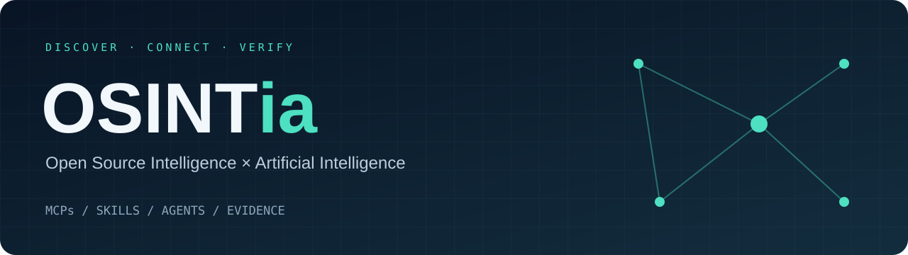

<strong>Awesome OSINT com Inteligência Artificial</strong> Fontes rastreáveis. Ferramentas conectáveis. Análise que pode ser revisada.

<a href="docs/START-HERE.md">Comece aqui</a> · <a href="docs/METHODOLOGY.md">Critérios de curadoria</a> · <a href="data/sources.json">JSON</a> · <a href="data/sources.csv">CSV</a> · <a href="CONTRIBUTING.md">Contribua</a>

Uma seleção comentada de **MCPs, skills, agentes e recursos para OSINT com IA**, cobrindo infraestrutura, CTI, SOCMINT, empresas, pesquisa documental e evidências. As descrições explicam a utilidade; as ressalvas ajudam a escolher o que avaliar primeiro.

> **English:** A curated, Portuguese-language directory of AI-assisted OSINT resources. Primary-source links, documented limitations and machine-readable provenance. Documentation checked; tools not runtime-tested. General research infrastructure is labeled separately from OSINT-specific workflows.

## Entenda as peças

| Peça | Papel | Exemplo |
|---|---|---|
| **MCP** | Dá ao agente acesso padronizado a ferramentas e fontes. | Consultar um indicador no VirusTotal. |
| **Skill** | Orienta planejamento, verificação, pivôs e relatório. | Separar observações de hipóteses. |
| **Agente** | Coordena etapas, ferramentas e estado da pesquisa. | Investigar uma pergunta e registrar lacunas. |
| **Workbench** | Organiza entidades, relações e evidências. | Revisar um grafo com fontes por relação. |

## Atalhos por objetivo

| Quero… | Começar por… |
|---|---|
| Estruturar o método | [OSINT Agent Skills](https://github.com/frangelbarrera/osint-agent-skills), [UseOSINT](https://github.com/UseOSINT/Skills) |
| Investigar infraestrutura | [Shodan MCP](https://github.com/w0h1v/mcp-shodan), [VirusTotal MCP](https://github.com/w0h1v/mcp-virustotal), [Wayback MCP](https://github.com/Mearman/mcp-wayback-machine) |
| Avaliar proteção de marca | [dnstwist MCP](https://github.com/w0h1v/mcp-dnstwist), [Maigret MCP](https://github.com/w0h1v/mcp-maigret) |
| Organizar relações e casos | [OGI](https://github.com/khashashin/ogi), [Huntkit](https://github.com/assafkip/huntkit) |
| Trabalhar com CTI existente | [MISP MCP](https://github.com/MISP/misp-mcp), [OpenCTI MCP](https://github.com/jhuntinfosec/mcp-opencti) |
| Aprender orquestração | [OSINT AI Agent / LangGraph](https://github.com/dazzyddos/OSINT_AI_Agent) |
| Pesquisar documentos | [Docling MCP](https://github.com/docling-project/docling-mcp), [Academia MCP](https://github.com/IlyaGusev/academia_mcp) |

Os atalhos são prioridades editoriais de avaliação, não um ranking de desempenho. Veja [cenários de aplicação](docs/START-HERE.md) e [notas críticas](docs/REVIEW-NOTES.md).

<!-- CATALOG:START -->

**76 repositórios únicos · 69 no núcleo · 5 de apoio · 2 índices.**

Contagem por repositório, sem multiplicar skills internas ou contar o mesmo projeto em várias categorias.

| Categoria | Fontes |
|---|---:|
| [Skills e método investigativo](#skills) | 18 |
| [MCPs de OSINT e SOCMINT](#mcp-osint) | 13 |
| [MCPs de threat intelligence](#mcp-cti) | 8 |
| [MCPs de empresas e registros públicos](#mcp-corporate) | 3 |
| [MCPs de busca e pesquisa documental](#mcp-search) | 12 |
| [Agentes e workbenches](#agents) | 15 |
| [Infraestrutura complementar](#support) | 5 |
| [Índices para descobrir novas fontes](#directories) | 2 |

> **Verificação documental em 17/10/2026. Nenhum projeto foi testado em execução nesta edição.** URLs e hashes das fontes estão no [JSON](data/sources.json) e no [CSV](data/sources.csv). Código público pode depender de serviços pagos; licenças e planos devem ser conferidos no projeto original.

## Skills e método investigativo

| Projeto / fonte primária | Aplicação | Limitação ou dependência |
|---|---|---|
| [frangelbarrera/osint-agent-skills](https://github.com/frangelbarrera/osint-agent-skills) | Método investigativo, pivôs, templates e integração MCP. | Instruções não garantem qualidade das conclusões. |
| [UseOSINT/Skills](https://github.com/UseOSINT/Skills) | Workflows modulares para investigação e produção de briefs. | Algumas fontes exigem APIs externas. |
| [carlosceja27/osint-agent](https://github.com/carlosceja27/osint-agent) | Planejamento, verificação e due diligence com registro de evidências. | É uma skill, apesar do nome agent. |
| [elementalsouls/Claude-OSINT](https://github.com/elementalsouls/Claude-OSINT) | Procedimentos de reconhecimento externo e documentação de achados. | Distinguir coleta passiva de interação direta. |
| [7onez/cti-expert](https://github.com/7onez/cti-expert) | Procedimentos de CTI e pesquisa de indicadores com IA. | Revisar atribuição e níveis de confiança. |
| [jamditis/claude-skills-journalism](https://github.com/jamditis/claude-skills-journalism) | Skills de pesquisa jornalística, fontes e registros públicos. | Adaptar fontes e procedimentos ao país investigado. |
| [reichaves/osint-investigation](https://github.com/reichaves/osint-investigation) | Orientações para investigação, verificação e geolocalização. | Corroborar hipóteses geradas pelo modelo. |
| [MrBridgeHQ/osint-researcher-claude](https://github.com/MrBridgeHQ/osint-researcher-claude) | Procedimentos para pesquisa OSINT e relatórios. | Não substitui revisão de evidências. |
| [lawriec/claude-osint-plugin](https://github.com/lawriec/claude-osint-plugin) | Plugin com método investigativo e integrações de ferramentas. | Revisar configurações e credenciais de conectores. |
| [soxoj/claude-osint-deploy](https://github.com/soxoj/claude-osint-deploy) | Skill para preparar ferramentas OSINT em sessões de agentes. | Pode instalar dependências e executar comandos. |
| [SOsintOps/claudii-exploratores](https://github.com/SOsintOps/claudii-exploratores) | Índice de ferramentas, consultas e validação de identificadores. | Mantenedor classifica como alpha; validar saídas e catálogo. |
| [mtjikuzu/hermes-osint-skill](https://github.com/mtjikuzu/hermes-osint-skill) | Procedimentos de due diligence e pesquisa de organizações. | Integração orientada ao Hermes. |
| [indigokarasu/scout](https://github.com/indigokarasu/scout) | Pesquisa estruturada de pessoas e empresas com proveniência. | Correspondências entre entidades precisam de revisão. |
| [mvanhorn/last30days-skill](https://github.com/mvanhorn/last30days-skill) | Pesquisa de discussões recentes na web e comunidades. | Recência e popularidade não indicam representatividade. |
| [zomin/chinese-osint-skills](https://github.com/zomin/chinese-osint-skills) | Métodos e scripts para pesquisa em plataformas chinesas. | Cobertura e acesso variam por plataforma. |
| [WPTK/aircraft-research-claude-skill](https://github.com/WPTK/aircraft-research-claude-skill) | Pesquisa de aeronaves e entidades proprietárias em fontes públicas. | Fluxo aprofundado centrado em registros dos EUA; propriedade exige confirmação. |
| [soxoj/web-multi-search-skill](https://github.com/soxoj/web-multi-search-skill) | Consultas em vários buscadores e organização dos resultados. | Deduplicar republicações da mesma fonte. |
| [jeremylongworth-source/AgentInvestigate](https://github.com/jeremylongworth-source/AgentInvestigate) | Procedimentos de investigação, evidências e análise. | Amplitude declarada não equivale a validação profissional. |

[↑ Voltar ao início](#osintia)

## MCPs de OSINT e SOCMINT

| Projeto / fonte primária | Aplicação | Limitação ou dependência |
|---|---|---|
| [frishtik/osint-tools-mcp-server](https://github.com/frishtik/osint-tools-mcp-server) | Ponte MCP para ferramentas clássicas de OSINT. | Dependências e coletores têm manutenção independente. |
| [rjn32s/osint-mcp](https://github.com/rjn32s/osint-mcp) | Servidor MCP que reúne ferramentas de reconhecimento. | Instalação automática de binários exige revisão. |
| [w0h1v/mcp-maigret](https://github.com/w0h1v/mcp-maigret) | Pesquisa de usernames por meio do Maigret. | Username igual não confirma identidade. |
| [w0h1v/mcp-shodan](https://github.com/w0h1v/mcp-shodan) | Consulta de infraestrutura indexada no Shodan. | API e cobertura dependem do provedor. |
| [w0h1v/mcp-dnstwist](https://github.com/w0h1v/mcp-dnstwist) | Pesquisa de variantes de domínios usando dnstwist. | Variação lexical não comprova fraude. |
| [Mearman/mcp-wayback-machine](https://github.com/Mearman/mcp-wayback-machine) | Acesso ao histórico de páginas no Internet Archive. | Ausência de captura não prova ausência histórica. |
| [cyanheads/internet-archive-mcp-server](https://github.com/cyanheads/internet-archive-mcp-server) | Pesquisa e acesso a recursos do Internet Archive. | Verificar data, origem e completude dos registros. |
| [dialog-tools/reddit-research-mcp](https://github.com/dialog-tools/reddit-research-mcp) | Pesquisa e recuperação de conteúdo do Reddit. | Dados podem ser removidos ou incompletos. |
| [coyaSONG/youtube-mcp-server](https://github.com/coyaSONG/youtube-mcp-server) | Acesso a informações de vídeos e canais do YouTube. | Legendas automáticas exigem conferência. |
| [tolboy/telegram-mcp-tdlib](https://github.com/tolboy/telegram-mcp-tdlib) | Integração Telegram via TDLib. | Exige sessão; separar leitura de ações de escrita. |
| [LeakIX/leakix-mcp](https://github.com/LeakIX/leakix-mcp) | Consulta de infraestrutura indexada pelo LeakIX. | Exige chave da API LeakIX; cobertura depende do índice. |
| [gglessner/OSINT-MCP](https://github.com/gglessner/OSINT-MCP) | Pesquisa de empresas, domínios e infraestrutura. | Fontes externas podem impor limites de acesso. |
| [marc-shade/world-intel-mcp](https://github.com/marc-shade/world-intel-mcp) | Agregação de fontes para inteligência situacional. | Alertas precisam de verificação independente. |

[↑ Voltar ao início](#osintia)

## MCPs de threat intelligence

| Projeto / fonte primária | Aplicação | Limitação ou dependência |
|---|---|---|
| [w0h1v/mcp-virustotal](https://github.com/w0h1v/mcp-virustotal) | Enriquecimento de indicadores e relações pelo VirusTotal. | API externa; detecção não equivale a atribuição. |
| [MISP/misp-mcp](https://github.com/MISP/misp-mcp) | Acesso de leitura a inteligência armazenada no MISP. | Exige instância e permissões adequadas. |
| [jhuntinfosec/mcp-opencti](https://github.com/jhuntinfosec/mcp-opencti) | Consultas e exploração de relações no OpenCTI. | Exige instância OpenCTI e token. |
| [DarkAngel-agents/opencti-mcp](https://github.com/DarkAngel-agents/opencti-mcp) | Conector MCP para OpenCTI. | Comparar cobertura com outros conectores antes de escolher. |
| [CooperCyberCoffee/opencti_mcp_server](https://github.com/CooperCyberCoffee/opencti_mcp_server) | Interface MCP para pesquisa no OpenCTI. | Implantação e compatibilidade precisam de teste local. |
| [gbrigandi/mcp-server-misp](https://github.com/gbrigandi/mcp-server-misp) | Implementação alternativa de MCP para MISP. | Revisar operações expostas e permissões. |
| [mukul975/cve-mcp-server](https://github.com/mukul975/cve-mcp-server) | Pesquisa de vulnerabilidades e enriquecimento contextual. | CVE aplicável exige confirmação de produto e versão. |
| [bonetrees/osint-mcp-gateway](https://github.com/bonetrees/osint-mcp-gateway) | Gateway de consultas a fontes de infraestrutura e CTI. | Chaves e disponibilidade variam entre fontes. |

[↑ Voltar ao início](#osintia)

## MCPs de empresas e registros públicos

| Projeto / fonte primária | Aplicação | Limitação ou dependência |
|---|---|---|
| [cyanheads/sanctions-screening-mcp-server](https://github.com/cyanheads/sanctions-screening-mcp-server) | Triagem de nomes em sanções e resolução de entidades. | Correspondência aproximada não é determinação de sanção. |
| [OctagonAI/octagon-mcp-server](https://github.com/OctagonAI/octagon-mcp-server) | Pesquisa empresarial e financeira por MCP. | Serviço externo; confirmar planos e cobertura. |
| [Hack23/European-Parliament-MCP-Server](https://github.com/Hack23/European-Parliament-MCP-Server) | Acesso a dados públicos do Parlamento Europeu. | Cobertura institucional europeia. |

[↑ Voltar ao início](#osintia)

## MCPs de busca e pesquisa documental

| Projeto / fonte primária | Aplicação | Limitação ou dependência |
|---|---|---|
| [apify/apify-mcp-server](https://github.com/apify/apify-mcp-server) | Execução de Actors e acesso a coleta web por MCP. | Actors têm custos e condições próprios. |
| [firecrawl/firecrawl-mcp-server](https://github.com/firecrawl/firecrawl-mcp-server) | Busca, coleta e extração web para agentes. | Credenciais, limites e custos variam por implantação. |
| [exa-labs/exa-mcp-server](https://github.com/exa-labs/exa-mcp-server) | Busca semântica e recuperação de conteúdo. | API externa; resultados precisam de verificação. |
| [tavily-ai/tavily-mcp](https://github.com/tavily-ai/tavily-mcp) | Busca e extração web para workflows de pesquisa. | API externa e limites por plano. |
| [brave/brave-search-mcp-server](https://github.com/brave/brave-search-mcp-server) | Pesquisa web por meio da API Brave Search. | Exige configuração de acesso ao serviço. |
| [brightdata/brightdata-mcp](https://github.com/brightdata/brightdata-mcp) | Coleta e acesso a fontes web via Bright Data. | Serviço externo com cobrança e configuração próprias. |
| [spences10/mcp-omnisearch](https://github.com/spences10/mcp-omnisearch) | Integração de múltiplos provedores de pesquisa. | Dependências e custos acumulam conforme provedores. |
| [pminervini/deep-research-mcp](https://github.com/pminervini/deep-research-mcp) | Integração de pesquisa aprofundada com MCP. | Modelos e serviços externos precisam de configuração. |
| [docling-project/docling-mcp](https://github.com/docling-project/docling-mcp) | Conversão e extração estruturada de documentos via MCP. | Conferir tabelas, OCR e referências de página. |
| [datacommonsorg/agent-toolkit](https://github.com/datacommonsorg/agent-toolkit) | Acesso agentic ao grafo público do Data Commons. | Observar definições, unidades e período dos indicadores. |
| [IlyaGusev/academia_mcp](https://github.com/IlyaGusev/academia_mcp) | Pesquisa de literatura acadêmica por MCP. | Metadados não substituem leitura do artigo. |
| [oksure/openalex-research-mcp](https://github.com/oksure/openalex-research-mcp) | Pesquisa de obras, autores e relações no OpenAlex. | Desambiguação de autores exige cuidado. |

[↑ Voltar ao início](#osintia)

## Agentes e workbenches

| Projeto / fonte primária | Aplicação | Limitação ou dependência |
|---|---|---|
| [OpenOSINT/OpenOSINT](https://github.com/OpenOSINT/OpenOSINT) | Agente investigativo com CLI, interface web e MCP. | Ferramentas reais não eliminam erros de interpretação. |
| [khashashin/ogi](https://github.com/khashashin/ogi) | Workbench de grafos com investigador de IA opcional. | Backend, workers e provedores exigem configuração. |
| [dazzyddos/OSINT_AI_Agent](https://github.com/dazzyddos/OSINT_AI_Agent) | Exemplo de coordenação de agentes OSINT com LangGraph. | Projeto didático; não tratar como plataforma validada. |
| [roxm337/osint-agent](https://github.com/roxm337/osint-agent) | Orquestração de reconhecimento e evidências com LLM. | README informa ausência de enforcement de escopo; inclui operações ativas. |
| [frangelbarrera/Abster-Intelligence](https://github.com/frangelbarrera/Abster-Intelligence) | Ambiente investigativo local com integração de ferramentas. | Avaliar maturidade e dependências da implantação. |
| [grammy-jiang/intelligence-analysis-agent](https://github.com/grammy-jiang/intelligence-analysis-agent) | Análise estruturada com evidências e hipóteses. | Recursos experimentais e gates precisam de conferência. |
| [scottmartinanderson/clearfront](https://github.com/scottmartinanderson/clearfront) | Pesquisa da própria exposição digital com agentes. | Ausência de achados não significa ausência de exposição. |
| [assafkip/huntkit](https://github.com/assafkip/huntkit) | Organização de casos, achados, timelines e evidências. | Registros de integridade não comprovam veracidade. |
| [ThreatRecall/zettelforge](https://github.com/ThreatRecall/zettelforge) | Extração de entidades de CTI para base de conhecimento. | Revisar entidades e relações extraídas por IA. |
| [assafelovic/gpt-researcher](https://github.com/assafelovic/gpt-researcher) | Pesquisa web automatizada e relatórios com referências. | Uso geral; requer método OSINT adicional. |
| [bytedance/deer-flow](https://github.com/bytedance/deer-flow) | Orquestração de pesquisa com ferramentas e agentes. | Uso geral; impor critérios de evidência. |
| [dzhng/deep-research](https://github.com/dzhng/deep-research) | Pesquisa iterativa e síntese de resultados web. | Verificar cada alegação relevante nas fontes originais. |
| [u14app/deep-research](https://github.com/u14app/deep-research) | Aplicação de pesquisa com modelos configuráveis. | Custos e cobertura dependem dos provedores. |
| [sansan0/TrendRadar](https://github.com/sansan0/TrendRadar) | Monitoramento e análise de notícias com integrações de IA. | Republicações podem inflar a importância de um evento. |
| [gs-ai/SYNINT](https://github.com/gs-ai/SYNINT) | Pipeline investigativo com evidências e checkpoints. | Revisar módulos selecionados e interações de rede. |

[↑ Voltar ao início](#osintia)

## Infraestrutura complementar

| Projeto / fonte primária | Aplicação | Limitação ou dependência |
|---|---|---|
| [browser-use/browser-use](https://github.com/browser-use/browser-use) | Automação de navegação por agentes de IA. | Infraestrutura de coleta, não método OSINT completo. |
| [D4Vinci/Scrapling](https://github.com/D4Vinci/Scrapling) | Extração web e integração em fluxos de agentes. | Páginas dinâmicas e mudanças de layout exigem validação. |
| [browserbase/stagehand](https://github.com/browserbase/stagehand) | SDK para navegação e extração assistida por IA. | Conferir ações antes de usar sessões autenticadas. |
| [ArchiveBox/abx-dl](https://github.com/ArchiveBox/abx-dl) | Captura de páginas, mídia e artefatos web. | Preservação não garante que o conteúdo seja verdadeiro. |
| [osintshifu/filegrail](https://github.com/osintshifu/filegrail) | Análise local de metadados e proveniência de arquivos com MCP. | Metadados podem ser alterados ou removidos. |

[↑ Voltar ao início](#osintia)

## Índices para descobrir novas fontes

| Projeto / fonte primária | Aplicação | Limitação ou dependência |
|---|---|---|
| [soxoj/awesome-osint-mcp-servers](https://github.com/soxoj/awesome-osint-mcp-servers) | Índice de conectores MCP relacionados a OSINT. | Catálogo de descoberta; não auditoria dos projetos. |
| [osintshifu/awesome-osint-repos](https://github.com/osintshifu/awesome-osint-repos) | Catálogo de ferramentas e integrações agentic. | Conferir cada projeto na fonte primária. |

[↑ Voltar ao início](#osintia)

<!-- CATALOG:END -->

## Mantenha a lista útil

Prefira fontes primárias, descreva limites e diferencie disponibilidade de funcionamento. Não conte republicações como confirmações independentes. [Leia os critérios](docs/METHODOLOGY.md) e [proponha uma fonte](CONTRIBUTING.md).

Esta curadoria não implica afiliação ou endosso dos projetos citados. Cada projeto mantém sua própria licença e condições de uso.
