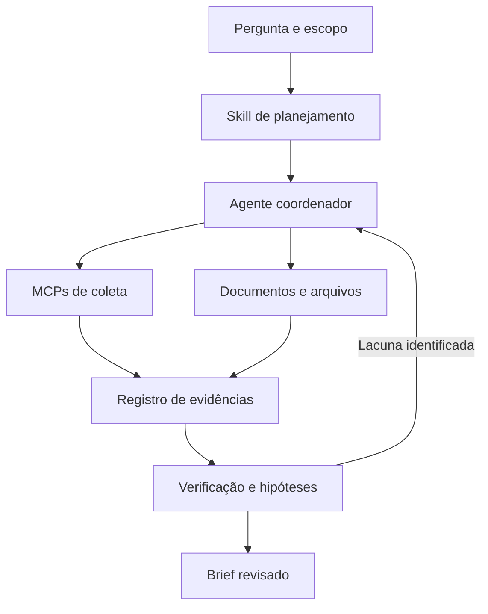

# Comece pelo problema investigativo

## Infraestrutura e CTI

**Pergunta:** quais relações públicas sustentam uma hipótese sobre um domínio?

Combine uma skill de planejamento com Shodan MCP, VirusTotal MCP e Wayback. Use OpenCTI ou MISP quando já houver uma base para consultar. Preserve timestamps, resultados negativos e fontes; hospedagem compartilhada não é atribuição de autoria.

## Proteção de marca

**Pergunta:** quais domínios e perfis públicos merecem revisão por possível impersonação?

Combine dnstwist, Maigret e pesquisa web. Diferencie semelhança lexical, existência do recurso e evidência de imitação. Mantenha amostras negativas para medir falsos positivos. Não converta correspondência de username em identidade confirmada.

## Jornalismo e investigação empresarial

**Pergunta:** quais documentos sustentam uma relação entre organizações?

Use skills de jornalismo ou due diligence, buscas públicas, registros corporativos e Docling para documentos. Construa um grafo no OGI apenas com relações rastreáveis. Correspondências aproximadas em sanções são candidatos à revisão, nunca vereditos.

## GEOINT e verificação de mídia

**Pergunta:** quais pistas sustentam onde e quando uma imagem foi produzida?

Use uma skill de geolocalização, arquivos históricos e inspeção documental. Registre hipóteses alternativas, pistas contraditórias e limites da resolução. Não escreva coordenadas inferidas nos metadados do original como se fossem observações reais.

## Pesquisa de tendências

**Pergunta:** quais mudanças aparecem em fontes públicas durante um período definido?

Avalie last30days, TrendRadar e um agente de pesquisa geral. Defina janela temporal, idiomas e fontes; deduplique republicações. Popularidade, volume de posts e repetição não são medidas automáticas de prevalência real.

## Arquitetura de referência



## Contrato mínimo de um achado

```json
{
  "claim": "Alegação observável e delimitada",
  "entity": "Identificador da entidade",
  "source_url": "https://example.org/source",
  "collected_at": "2026-10-17T11:00:00Z",
  "source_published_at": null,
  "supporting_excerpt": "Trecho que sustenta a alegação",
  "artifact_sha256": null,
  "assessment": "unverified",
  "alternative_explanations": [],
  "reviewer": null
}
```

O registro acima é um exemplo de esquema, não evidência real. O hash protege a comparação de integridade de um artefato; não verifica seu conteúdo factual.
